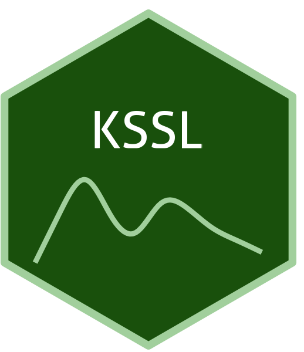

```{=html}
<div class="ossl-hero" style="background: #E0FFDD;">
  <div class="ossl-hero-logo">
    
  </div>
  <div class="ossl-hero-text">
    <h1 class="ossl-hero-title">KSSL</h1>
    <p class="ossl-hero-desc">The USDA-NRCS NCSS Kellogg Soil Survey Laboratory (KSSL) soil libraries from the United States and other territories</p>
    <div class="ossl-hero-meta">
      <div class="ossl-pill-row">
        <span class="ossl-pill ossl-pill-on">VNIR</span>
        <span class="ossl-pill ossl-pill-off">NIR</span>
        <span class="ossl-pill ossl-pill-on">MIR</span>
      </div>
      <span class="ossl-meta-divider"></span>
      <span class="ossl-meta-item"><i class="bi bi-globe-americas" aria-hidden="true"></i>National — USA</span>
    </div>
  </div>
</div>
<div class="ossl-quick-stats">
  <span class="ossl-stat-item"><i class="bi bi-database" aria-hidden="true"></i><span class="ossl-stat-val">60,000+</span> samples</span>
  <span class="ossl-stat-item"><i class="bi bi-calendar3" aria-hidden="true"></i><span class="ossl-stat-val">Snapshot Jul 2025</span></span>
  <span class="ossl-stat-item"><i class="bi bi-file-earmark-text" aria-hidden="true"></i><span class="ossl-stat-val">Other (Custom)</span></span>
</div>

```

## <i class="bi bi-cloud-download ossl-section-icon" aria-hidden="true"></i> Database access

Data originally provided by:

- **Contact:** Scarlett Murphy
- **Email:** [Scarlett.Murphy@usda.gov](mailto:Scarlett.Murphy@usda.gov)
- **Original source:** <https://ncsslabdatamart.sc.egov.usda.gov/>

**Available files**

| Type | Filename | Link |
|------|----------|------|
| MIR spectra — CSV (gzip) | `ossl_mir_v1.3.csv.gz` | [Download](https://storage.googleapis.com/soilspec4gg-public/datasets/KSSL/ossl_mir_v1.3.csv.gz) |
| MIR spectra — Parquet | `ossl_mir_v1.3.parquet` | [Download](https://storage.googleapis.com/soilspec4gg-public/datasets/KSSL/ossl_mir_v1.3.parquet) |
| Soil lab measurements — CSV (gzip) | `ossl_soillab_v1.3.csv.gz` | [Download](https://storage.googleapis.com/soilspec4gg-public/datasets/KSSL/ossl_soillab_v1.3.csv.gz) |
| Soil lab measurements — Parquet | `ossl_soillab_v1.3.parquet` | [Download](https://storage.googleapis.com/soilspec4gg-public/datasets/KSSL/ossl_soillab_v1.3.parquet) |
| Soil site metadata — CSV (gzip) | `ossl_soilsite_v1.3.csv.gz` | [Download](https://storage.googleapis.com/soilspec4gg-public/datasets/KSSL/ossl_soilsite_v1.3.csv.gz) |
| Soil site metadata — Parquet | `ossl_soilsite_v1.3.parquet` | [Download](https://storage.googleapis.com/soilspec4gg-public/datasets/KSSL/ossl_soilsite_v1.3.parquet) |
| VisNIR spectra — CSV (gzip) | `ossl_visnir_v1.3.csv.gz` | [Download](https://storage.googleapis.com/soilspec4gg-public/datasets/KSSL/ossl_visnir_v1.3.csv.gz) |
| VisNIR spectra — Parquet | `ossl_visnir_v1.3.parquet` | [Download](https://storage.googleapis.com/soilspec4gg-public/datasets/KSSL/ossl_visnir_v1.3.parquet) |


## <i class="bi bi-geo-alt ossl-section-icon" aria-hidden="true"></i> Map


## <i class="bi bi-pin-map ossl-section-icon" aria-hidden="true"></i> Soil site information

- **Coordinates precision:** precise, county, country
- **Sampling depth:** various
- **Geography:** soil taxonomy, soil horizon
- **Variables available (OSSL):** 14 out of 14 — see [Database description](../db-desc.html#panel-soilsite) for full schema
- **Populated columns:** `id.layer_local_c`, `id.layer_uuid_txt`, `id.dataset.site_ascii_txt`, `layer.upper.depth_usda_cm`, `layer.lower.depth_usda_cm`, `layer.texture_usda_txt`, `pedon.taxa_usda_txt`, `horizon.designation_usda_txt`, `observation.date.begin_iso.8601_yyyy.mm.dd`, `observation.date.end_iso.8601_yyyy.mm.dd`, `longitude.point_wgs84_dd`, `latitude.point_wgs84_dd`, `longitude.county_wgs84_dd`, `latitude.county_wgs84_dd`

## <i class="bi bi-clipboard-data ossl-section-icon" aria-hidden="true"></i> Soil laboratory information

- **Total samples:** 64,667
- **Properties available (original):** 1000+
- **Properties standardized (OSSL):** 51 — summarized in **@tbl-soillab-kssl** below
- **Categories:** physical, chemical, biological, hydrological, carbon & nutrients, metal elements
- **Original source:** see [Database access](#database-access)

```{=html}
<p class="ossl-tt-hint"><i class="bi bi-info-circle" aria-hidden="true"></i> Hover over any OSSL code in the table below to see its full description.</p>
```

::: {#tbl-soillab-kssl}

```{=html}
<table class="soil-lab-table"><thead><tr><th style="text-align:left">skim_variable</th><th style="text-align:right">n_missing</th><th style="text-align:right">mean</th><th style="text-align:right">sd</th><th style="text-align:right">p0</th><th style="text-align:right">p25</th><th style="text-align:right">p50</th><th style="text-align:right">p75</th><th style="text-align:right">p100</th></tr></thead><tbody><tr><td style="text-align:left"><span class="ossl-tt">acidity_usda.a795_cmolc.kg<span class="ossl-tt-pop"><span class="tt-analyte">Acidity, BaCl2-TEA Extractable, pH 8.2</span><span class="tt-desc">Method: <code>usda.a795</code></span><span class="tt-unit">Unit: <code>cmolc.kg</code></span></span></span></td><td style="text-align:right">29776</td><td style="text-align:right">14.47</td><td style="text-align:right">24.31</td><td style="text-align:right">0.00</td><td style="text-align:right">3.70</td><td style="text-align:right">7.14</td><td style="text-align:right">13.48</td><td style="text-align:right">291.92</td></tr><tr><td style="text-align:left"><span class="ossl-tt">aggstb_usda.a1_w.pct<span class="ossl-tt-pop"><span class="tt-analyte">Aggregate Stability</span><span class="tt-desc">Method: <code>usda.a1</code></span><span class="tt-unit">Unit: <code>w.pct</code></span></span></span></td><td style="text-align:right">60668</td><td style="text-align:right">39.45</td><td style="text-align:right">30.11</td><td style="text-align:right">0.00</td><td style="text-align:right">12.00</td><td style="text-align:right">33.00</td><td style="text-align:right">65.00</td><td style="text-align:right">123.00</td></tr><tr><td style="text-align:left"><span class="ossl-tt">al.dith_usda.a65_w.pct<span class="ossl-tt-pop"><span class="tt-analyte">Aluminum, Crystalline, Total Pedogenic Iron</span><span class="tt-desc">Method: <code>usda.a65</code></span><span class="tt-unit">Unit: <code>w.pct</code></span></span></span></td><td style="text-align:right">26780</td><td style="text-align:right">0.20</td><td style="text-align:right">0.35</td><td style="text-align:right">0.00</td><td style="text-align:right">0.05</td><td style="text-align:right">0.11</td><td style="text-align:right">0.21</td><td style="text-align:right">7.70</td></tr><tr><td style="text-align:left"><span class="ossl-tt">al.ext_usda.a1056_mg.kg<span class="ossl-tt-pop"><span class="tt-analyte">Aluminum, Extractable, Mehlich3</span><span class="tt-desc">Method: <code>usda.a1056</code></span><span class="tt-unit">Unit: <code>mg.kg</code></span></span></span></td><td style="text-align:right">63153</td><td style="text-align:right">878.63</td><td style="text-align:right">774.47</td><td style="text-align:right">0.07</td><td style="text-align:right">318.70</td><td style="text-align:right">751.04</td><td style="text-align:right">1158.34</td><td style="text-align:right">6748.01</td></tr><tr><td style="text-align:left"><span class="ossl-tt">al.ext_usda.a69_cmolc.kg<span class="ossl-tt-pop"><span class="tt-analyte">Aluminum, Extractable, KCl</span><span class="tt-desc">Method: <code>usda.a69</code></span><span class="tt-unit">Unit: <code>cmolc.kg</code></span></span></span></td><td style="text-align:right">47387</td><td style="text-align:right">2.27</td><td style="text-align:right">3.39</td><td style="text-align:right">0.00</td><td style="text-align:right">0.31</td><td style="text-align:right">1.03</td><td style="text-align:right">2.88</td><td style="text-align:right">63.01</td></tr><tr><td style="text-align:left"><span class="ossl-tt">al.ox_usda.a59_w.pct<span class="ossl-tt-pop"><span class="tt-analyte">Aluminum, Amorphous, Total Non-Crystalline Iron</span><span class="tt-desc">Method: <code>usda.a59</code></span><span class="tt-unit">Unit: <code>w.pct</code></span></span></span></td><td style="text-align:right">32485</td><td style="text-align:right">0.27</td><td style="text-align:right">0.56</td><td style="text-align:right">0.00</td><td style="text-align:right">0.06</td><td style="text-align:right">0.12</td><td style="text-align:right">0.23</td><td style="text-align:right">12.63</td></tr><tr><td style="text-align:left"><span class="ossl-tt">awc.33.1500kPa_usda.c80_w.frac<span class="ossl-tt-pop"><span class="tt-analyte">Available Water Content, Difference 33-1500 kPa</span><span class="tt-desc">Method: <code>usda.c80</code></span><span class="tt-unit">Unit: <code>w.frac</code></span></span></span></td><td style="text-align:right">43223</td><td style="text-align:right">0.15</td><td style="text-align:right">0.07</td><td style="text-align:right">0.00</td><td style="text-align:right">0.11</td><td style="text-align:right">0.14</td><td style="text-align:right">0.19</td><td style="text-align:right">0.81</td></tr><tr><td style="text-align:left"><span class="ossl-tt">bd_usda.a21_g.cm3<span class="ossl-tt-pop"><span class="tt-analyte">Bulk Density, &lt;2 mm fraction, Core</span><span class="tt-desc">Method: <code>usda.a21</code></span><span class="tt-unit">Unit: <code>g.cm3</code></span></span></span></td><td style="text-align:right">57051</td><td style="text-align:right">0.94</td><td style="text-align:right">0.50</td><td style="text-align:right">0.01</td><td style="text-align:right">0.53</td><td style="text-align:right">1.04</td><td style="text-align:right">1.32</td><td style="text-align:right">8.10</td></tr><tr><td style="text-align:left"><span class="ossl-tt">bd_usda.a4_g.cm3<span class="ossl-tt-pop"><span class="tt-analyte">Bulk Density, &lt;2mm fraction, Clod</span><span class="tt-desc">Method: <code>usda.a4</code></span><span class="tt-unit">Unit: <code>g.cm3</code></span></span></span></td><td style="text-align:right">42189</td><td style="text-align:right">1.38</td><td style="text-align:right">0.26</td><td style="text-align:right">0.02</td><td style="text-align:right">1.26</td><td style="text-align:right">1.40</td><td style="text-align:right">1.54</td><td style="text-align:right">2.53</td></tr><tr><td style="text-align:left"><span class="ossl-tt">c.tot_usda.a622_w.pct<span class="ossl-tt-pop"><span class="tt-analyte">Carbon, Total NCS</span><span class="tt-desc">Method: <code>usda.a622</code></span><span class="tt-unit">Unit: <code>w.pct</code></span></span></span></td><td style="text-align:right">223</td><td style="text-align:right">4.33</td><td style="text-align:right">9.51</td><td style="text-align:right">0.00</td><td style="text-align:right">0.41</td><td style="text-align:right">1.27</td><td style="text-align:right">3.13</td><td style="text-align:right">63.45</td></tr><tr><td style="text-align:left"><span class="ossl-tt">ca.ext_usda.a1059_mg.kg<span class="ossl-tt-pop"><span class="tt-analyte">Calcium, Extractable, Mehlich3</span><span class="tt-desc">Method: <code>usda.a1059</code></span><span class="tt-unit">Unit: <code>mg.kg</code></span></span></span></td><td style="text-align:right">63153</td><td style="text-align:right">5634.75</td><td style="text-align:right">9321.06</td><td style="text-align:right">3.09</td><td style="text-align:right">656.32</td><td style="text-align:right">2258.41</td><td style="text-align:right">4789.45</td><td style="text-align:right">44723.96</td></tr><tr><td style="text-align:left"><span class="ossl-tt">ca.ext_usda.a722_cmolc.kg<span class="ossl-tt-pop"><span class="tt-analyte">Calcium, Extractable, NH4OAc</span><span class="tt-desc">Method: <code>usda.a722</code></span><span class="tt-unit">Unit: <code>cmolc.kg</code></span></span></span></td><td style="text-align:right">4650</td><td style="text-align:right">22.04</td><td style="text-align:right">32.60</td><td style="text-align:right">0.00</td><td style="text-align:right">2.94</td><td style="text-align:right">11.46</td><td style="text-align:right">29.25</td><td style="text-align:right">388.18</td></tr><tr><td style="text-align:left"><span class="ossl-tt">caco3_usda.a54_w.pct<span class="ossl-tt-pop"><span class="tt-analyte">Carbonate, &lt;2mm Fraction</span><span class="tt-desc">Method: <code>usda.a54</code></span><span class="tt-unit">Unit: <code>w.pct</code></span></span></span></td><td style="text-align:right">41377</td><td style="text-align:right">9.42</td><td style="text-align:right">14.87</td><td style="text-align:right">0.00</td><td style="text-align:right">0.26</td><td style="text-align:right">2.56</td><td style="text-align:right">13.24</td><td style="text-align:right">105.77</td></tr><tr><td style="text-align:left"><span class="ossl-tt">cec_usda.a723_cmolc.kg<span class="ossl-tt-pop"><span class="tt-analyte">CEC, pH 7.0, NH4OAc, 2M KCl displacement</span><span class="tt-desc">Method: <code>usda.a723</code></span><span class="tt-unit">Unit: <code>cmolc.kg</code></span></span></span></td><td style="text-align:right">4656</td><td style="text-align:right">20.63</td><td style="text-align:right">22.91</td><td style="text-align:right">0.00</td><td style="text-align:right">7.49</td><td style="text-align:right">14.97</td><td style="text-align:right">24.63</td><td style="text-align:right">584.59</td></tr><tr><td style="text-align:left"><span class="ossl-tt">cf_usda.c236_w.pct<span class="ossl-tt-pop"><span class="tt-analyte">Coarse Fragments, Greater 2mm</span><span class="tt-desc">Method: <code>usda.c236</code></span><span class="tt-unit">Unit: <code>w.pct</code></span></span></span></td><td style="text-align:right">1655</td><td style="text-align:right">8.79</td><td style="text-align:right">17.05</td><td style="text-align:right">0.00</td><td style="text-align:right">0.00</td><td style="text-align:right">0.41</td><td style="text-align:right">8.00</td><td style="text-align:right">100.00</td></tr><tr><td style="text-align:left"><span class="ossl-tt">clay.tot_usda.a334_w.pct<span class="ossl-tt-pop"><span class="tt-analyte">Clay</span><span class="tt-desc">Method: <code>usda.a334</code></span><span class="tt-unit">Unit: <code>w.pct</code></span></span></span></td><td style="text-align:right">8058</td><td style="text-align:right">22.87</td><td style="text-align:right">16.30</td><td style="text-align:right">0.00</td><td style="text-align:right">9.61</td><td style="text-align:right">20.84</td><td style="text-align:right">32.50</td><td style="text-align:right">96.14</td></tr><tr><td style="text-align:left"><span class="ossl-tt">cu.ext_usda.a1063_mg.kg<span class="ossl-tt-pop"><span class="tt-analyte">Copper, Extractable, Mehlich3</span><span class="tt-desc">Method: <code>usda.a1063</code></span><span class="tt-unit">Unit: <code>mg.kg</code></span></span></span></td><td style="text-align:right">63153</td><td style="text-align:right">2.59</td><td style="text-align:right">4.25</td><td style="text-align:right">0.00</td><td style="text-align:right">0.44</td><td style="text-align:right">1.66</td><td style="text-align:right">3.06</td><td style="text-align:right">77.82</td></tr><tr><td style="text-align:left"><span class="ossl-tt">ec_usda.a364_ds.m<span class="ossl-tt-pop"><span class="tt-analyte">Electrical Conductivity, (w/w)</span><span class="tt-desc">Method: <code>usda.a364</code></span><span class="tt-unit">Unit: <code>ds.m</code></span></span></span></td><td style="text-align:right">28827</td><td style="text-align:right">2.85</td><td style="text-align:right">12.00</td><td style="text-align:right">0.00</td><td style="text-align:right">0.11</td><td style="text-align:right">0.26</td><td style="text-align:right">0.87</td><td style="text-align:right">313.13</td></tr><tr><td style="text-align:left"><span class="ossl-tt">fe.dith_usda.a66_w.pct<span class="ossl-tt-pop"><span class="tt-analyte">Iron, Crystalline, Total Pedogenic Iron</span><span class="tt-desc">Method: <code>usda.a66</code></span><span class="tt-unit">Unit: <code>w.pct</code></span></span></span></td><td style="text-align:right">26778</td><td style="text-align:right">1.24</td><td style="text-align:right">1.64</td><td style="text-align:right">0.00</td><td style="text-align:right">0.32</td><td style="text-align:right">0.80</td><td style="text-align:right">1.55</td><td style="text-align:right">28.44</td></tr><tr><td style="text-align:left"><span class="ossl-tt">fe.ext_usda.a1064_mg.kg<span class="ossl-tt-pop"><span class="tt-analyte">Iron, Extractable, Mehlich3</span><span class="tt-desc">Method: <code>usda.a1064</code></span><span class="tt-unit">Unit: <code>mg.kg</code></span></span></span></td><td style="text-align:right">63153</td><td style="text-align:right">113.04</td><td style="text-align:right">124.91</td><td style="text-align:right">0.00</td><td style="text-align:right">51.58</td><td style="text-align:right">89.31</td><td style="text-align:right">140.02</td><td style="text-align:right">2708.08</td></tr><tr><td style="text-align:left"><span class="ossl-tt">fe.ox_usda.a60_w.pct<span class="ossl-tt-pop"><span class="tt-analyte">Iron, Amorphous, Total Non-Crystalline Iron</span><span class="tt-desc">Method: <code>usda.a60</code></span><span class="tt-unit">Unit: <code>w.pct</code></span></span></span></td><td style="text-align:right">32486</td><td style="text-align:right">0.43</td><td style="text-align:right">0.71</td><td style="text-align:right">0.00</td><td style="text-align:right">0.09</td><td style="text-align:right">0.23</td><td style="text-align:right">0.53</td><td style="text-align:right">22.27</td></tr><tr><td style="text-align:left"><span class="ossl-tt">k.ext_usda.a1065_mg.kg<span class="ossl-tt-pop"><span class="tt-analyte">Potassium, Extractable, Mehlich3</span><span class="tt-desc">Method: <code>usda.a1065</code></span><span class="tt-unit">Unit: <code>mg.kg</code></span></span></span></td><td style="text-align:right">63153</td><td style="text-align:right">177.58</td><td style="text-align:right">170.73</td><td style="text-align:right">0.00</td><td style="text-align:right">77.71</td><td style="text-align:right">139.78</td><td style="text-align:right">234.39</td><td style="text-align:right">1699.61</td></tr><tr><td style="text-align:left"><span class="ossl-tt">k.ext_usda.a725_cmolc.kg<span class="ossl-tt-pop"><span class="tt-analyte">Potassium, Extractable, NH4OAc, 2M KCl displacement</span><span class="tt-desc">Method: <code>usda.a725</code></span><span class="tt-unit">Unit: <code>cmolc.kg</code></span></span></span></td><td style="text-align:right">4652</td><td style="text-align:right">0.64</td><td style="text-align:right">1.04</td><td style="text-align:right">0.00</td><td style="text-align:right">0.14</td><td style="text-align:right">0.34</td><td style="text-align:right">0.72</td><td style="text-align:right">32.33</td></tr><tr><td style="text-align:left"><span class="ossl-tt">mg.ext_usda.a1066_mg.kg<span class="ossl-tt-pop"><span class="tt-analyte">Magnesium, Extractable, Mehlich3</span><span class="tt-desc">Method: <code>usda.a1066</code></span><span class="tt-unit">Unit: <code>mg.kg</code></span></span></span></td><td style="text-align:right">63153</td><td style="text-align:right">510.49</td><td style="text-align:right">528.72</td><td style="text-align:right">0.00</td><td style="text-align:right">91.39</td><td style="text-align:right">369.35</td><td style="text-align:right">788.47</td><td style="text-align:right">5608.60</td></tr><tr><td style="text-align:left"><span class="ossl-tt">mg.ext_usda.a724_cmolc.kg<span class="ossl-tt-pop"><span class="tt-analyte">Magnesium, Extractable, NH4OAc, 2M KCl displacement</span><span class="tt-desc">Method: <code>usda.a724</code></span><span class="tt-unit">Unit: <code>cmolc.kg</code></span></span></span></td><td style="text-align:right">4650</td><td style="text-align:right">5.36</td><td style="text-align:right">8.26</td><td style="text-align:right">0.00</td><td style="text-align:right">0.87</td><td style="text-align:right">2.82</td><td style="text-align:right">6.55</td><td style="text-align:right">172.64</td></tr><tr><td style="text-align:left"><span class="ossl-tt">mn.ext_usda.a1067_mg.kg<span class="ossl-tt-pop"><span class="tt-analyte">Manganese, Extractable, Mehlich3</span><span class="tt-desc">Method: <code>usda.a1067</code></span><span class="tt-unit">Unit: <code>mg.kg</code></span></span></span></td><td style="text-align:right">63153</td><td style="text-align:right">73.41</td><td style="text-align:right">81.38</td><td style="text-align:right">0.00</td><td style="text-align:right">16.19</td><td style="text-align:right">45.74</td><td style="text-align:right">102.72</td><td style="text-align:right">544.19</td></tr><tr><td style="text-align:left"><span class="ossl-tt">mn.ext_usda.a70_mg.kg<span class="ossl-tt-pop"><span class="tt-analyte">Manganese, Extractable, KCl</span><span class="tt-desc">Method: <code>usda.a70</code></span><span class="tt-unit">Unit: <code>mg.kg</code></span></span></span></td><td style="text-align:right">47390</td><td style="text-align:right">13.25</td><td style="text-align:right">103.15</td><td style="text-align:right">0.00</td><td style="text-align:right">0.12</td><td style="text-align:right">0.80</td><td style="text-align:right">4.10</td><td style="text-align:right">9787.33</td></tr><tr><td style="text-align:left"><span class="ossl-tt">n.tot_usda.a623_w.pct<span class="ossl-tt-pop"><span class="tt-analyte">Nitrogen, Total NCS, usda.a623</span><span class="tt-desc">Method: <code>usda.a623</code></span><span class="tt-unit">Unit: <code>w.pct</code></span></span></span></td><td style="text-align:right">223</td><td style="text-align:right">0.24</td><td style="text-align:right">0.55</td><td style="text-align:right">0.00</td><td style="text-align:right">0.04</td><td style="text-align:right">0.09</td><td style="text-align:right">0.20</td><td style="text-align:right">41.90</td></tr><tr><td style="text-align:left"><span class="ossl-tt">na.ext_usda.a1068_mg.kg<span class="ossl-tt-pop"><span class="tt-analyte">Sodium, Extractable, Mehlich3</span><span class="tt-desc">Method: <code>usda.a1068</code></span><span class="tt-unit">Unit: <code>mg.kg</code></span></span></span></td><td style="text-align:right">63153</td><td style="text-align:right">183.75</td><td style="text-align:right">701.06</td><td style="text-align:right">0.00</td><td style="text-align:right">12.05</td><td style="text-align:right">30.59</td><td style="text-align:right">104.68</td><td style="text-align:right">15207.10</td></tr><tr><td style="text-align:left"><span class="ossl-tt">na.ext_usda.a726_cmolc.kg<span class="ossl-tt-pop"><span class="tt-analyte">Sodium, Extractable, NH4OAc, 2M KCl displacement</span><span class="tt-desc">Method: <code>usda.a726</code></span><span class="tt-unit">Unit: <code>cmolc.kg</code></span></span></span></td><td style="text-align:right">4652</td><td style="text-align:right">3.95</td><td style="text-align:right">23.24</td><td style="text-align:right">0.00</td><td style="text-align:right">0.00</td><td style="text-align:right">0.02</td><td style="text-align:right">0.24</td><td style="text-align:right">868.36</td></tr><tr><td style="text-align:left"><span class="ossl-tt">oc_usda.c1059_w.pct<span class="ossl-tt-pop"><span class="tt-analyte">Organic Carbon, Total C without CaCO3, N prep</span><span class="tt-desc">Method: <code>usda.c1059</code></span><span class="tt-unit">Unit: <code>w.pct</code></span></span></span></td><td style="text-align:right">63499</td><td style="text-align:right">4.46</td><td style="text-align:right">9.77</td><td style="text-align:right">0.01</td><td style="text-align:right">0.50</td><td style="text-align:right">1.28</td><td style="text-align:right">2.81</td><td style="text-align:right">56.40</td></tr><tr><td style="text-align:left"><span class="ossl-tt">oc_usda.c729_w.pct<span class="ossl-tt-pop"><span class="tt-analyte">Organic Carbon, Total C without CaCO3, S prep</span><span class="tt-desc">Method: <code>usda.c729</code></span><span class="tt-unit">Unit: <code>w.pct</code></span></span></span></td><td style="text-align:right">2231</td><td style="text-align:right">3.95</td><td style="text-align:right">9.59</td><td style="text-align:right">0.00</td><td style="text-align:right">0.28</td><td style="text-align:right">0.82</td><td style="text-align:right">2.36</td><td style="text-align:right">63.45</td></tr><tr><td style="text-align:left"><span class="ossl-tt">p.ext_usda.a1070_mg.kg<span class="ossl-tt-pop"><span class="tt-analyte">Phosphorus, Extractable, Mehlich3</span><span class="tt-desc">Method: <code>usda.a1070</code></span><span class="tt-unit">Unit: <code>mg.kg</code></span></span></span></td><td style="text-align:right">63153</td><td style="text-align:right">22.20</td><td style="text-align:right">36.86</td><td style="text-align:right">0.00</td><td style="text-align:right">3.47</td><td style="text-align:right">10.64</td><td style="text-align:right">24.97</td><td style="text-align:right">506.24</td></tr><tr><td style="text-align:left"><span class="ossl-tt">p.ext_usda.a270_mg.kg<span class="ossl-tt-pop"><span class="tt-analyte">Phosphorus, Extractable, Bray1</span><span class="tt-desc">Method: <code>usda.a270</code></span><span class="tt-unit">Unit: <code>mg.kg</code></span></span></span></td><td style="text-align:right">56546</td><td style="text-align:right">18.52</td><td style="text-align:right">48.21</td><td style="text-align:right">0.00</td><td style="text-align:right">1.00</td><td style="text-align:right">4.49</td><td style="text-align:right">16.07</td><td style="text-align:right">1436.68</td></tr><tr><td style="text-align:left"><span class="ossl-tt">p.ext_usda.a274_mg.kg<span class="ossl-tt-pop"><span class="tt-analyte">Phosphorus, Extractable, Olsen</span><span class="tt-desc">Method: <code>usda.a274</code></span><span class="tt-unit">Unit: <code>mg.kg</code></span></span></span></td><td style="text-align:right">49180</td><td style="text-align:right">12.43</td><td style="text-align:right">20.91</td><td style="text-align:right">0.00</td><td style="text-align:right">1.74</td><td style="text-align:right">5.15</td><td style="text-align:right">14.59</td><td style="text-align:right">623.13</td></tr><tr><td style="text-align:left"><span class="ossl-tt">p.ext_usda.a652_mg.kg<span class="ossl-tt-pop"><span class="tt-analyte">Phosphorus, Extractable, Mehlich3</span><span class="tt-desc">Method: <code>usda.a652</code></span><span class="tt-unit">Unit: <code>mg.kg</code></span></span></span></td><td style="text-align:right">39184</td><td style="text-align:right">26.05</td><td style="text-align:right">159.17</td><td style="text-align:right">0.00</td><td style="text-align:right">2.45</td><td style="text-align:right">9.18</td><td style="text-align:right">29.22</td><td style="text-align:right">24425.23</td></tr><tr><td style="text-align:left"><span class="ossl-tt">ph.cacl2_usda.a477_index<span class="ossl-tt-pop"><span class="tt-analyte">pH, 1:2 Soil-CaCl2 Suspension, 0.01 M CaCl2</span><span class="tt-desc">Method: <code>usda.a477</code></span><span class="tt-unit">Unit: <code>index</code></span></span></span></td><td style="text-align:right">62992</td><td style="text-align:right">4.73</td><td style="text-align:right">1.25</td><td style="text-align:right">1.74</td><td style="text-align:right">3.74</td><td style="text-align:right">4.61</td><td style="text-align:right">5.60</td><td style="text-align:right">8.27</td></tr><tr><td style="text-align:left"><span class="ossl-tt">ph.cacl2_usda.a481_index<span class="ossl-tt-pop"><span class="tt-analyte">pH, 1:2 Soil-CaCl2 Suspension</span><span class="tt-desc">Method: <code>usda.a481</code></span><span class="tt-unit">Unit: <code>index</code></span></span></span></td><td style="text-align:right">5087</td><td style="text-align:right">5.93</td><td style="text-align:right">1.41</td><td style="text-align:right">2.14</td><td style="text-align:right">4.74</td><td style="text-align:right">5.76</td><td style="text-align:right">7.33</td><td style="text-align:right">10.68</td></tr><tr><td style="text-align:left"><span class="ossl-tt">ph.h2o_usda.a268_index<span class="ossl-tt-pop"><span class="tt-analyte">pH, 1:1 Soil-Water Suspension</span><span class="tt-desc">Method: <code>usda.a268</code></span><span class="tt-unit">Unit: <code>index</code></span></span></span></td><td style="text-align:right">5086</td><td style="text-align:right">6.44</td><td style="text-align:right">1.35</td><td style="text-align:right">1.97</td><td style="text-align:right">5.35</td><td style="text-align:right">6.32</td><td style="text-align:right">7.70</td><td style="text-align:right">10.70</td></tr><tr><td style="text-align:left"><span class="ossl-tt">s.tot_usda.a624_w.pct<span class="ossl-tt-pop"><span class="tt-analyte">Sulfur, Total NCS</span><span class="tt-desc">Method: <code>usda.a624</code></span><span class="tt-unit">Unit: <code>w.pct</code></span></span></span></td><td style="text-align:right">224</td><td style="text-align:right">0.16</td><td style="text-align:right">0.90</td><td style="text-align:right">0.00</td><td style="text-align:right">0.00</td><td style="text-align:right">0.01</td><td style="text-align:right">0.04</td><td style="text-align:right">25.24</td></tr><tr><td style="text-align:left"><span class="ossl-tt">sand.tot_usda.c405_w.pct<span class="ossl-tt-pop"><span class="tt-analyte">Sand, Total, N prep</span><span class="tt-desc">Method: <code>usda.c405</code></span><span class="tt-unit">Unit: <code>w.pct</code></span></span></span></td><td style="text-align:right">63774</td><td style="text-align:right">33.76</td><td style="text-align:right">27.17</td><td style="text-align:right">0.30</td><td style="text-align:right">8.90</td><td style="text-align:right">24.70</td><td style="text-align:right">59.70</td><td style="text-align:right">98.40</td></tr><tr><td style="text-align:left"><span class="ossl-tt">sand.tot_usda.c60_w.pct<span class="ossl-tt-pop"><span class="tt-analyte">Sand, Total, S prep</span><span class="tt-desc">Method: <code>usda.c60</code></span><span class="tt-unit">Unit: <code>w.pct</code></span></span></span></td><td style="text-align:right">8988</td><td style="text-align:right">39.33</td><td style="text-align:right">28.88</td><td style="text-align:right">0.10</td><td style="text-align:right">13.30</td><td style="text-align:right">34.70</td><td style="text-align:right">61.70</td><td style="text-align:right">100.00</td></tr><tr><td style="text-align:left"><span class="ossl-tt">silt.tot_usda.c407_w.pct<span class="ossl-tt-pop"><span class="tt-analyte">Silt, Total, N prep</span><span class="tt-desc">Method: <code>usda.c407</code></span><span class="tt-unit">Unit: <code>w.pct</code></span></span></span></td><td style="text-align:right">63774</td><td style="text-align:right">35.09</td><td style="text-align:right">15.41</td><td style="text-align:right">0.90</td><td style="text-align:right">24.40</td><td style="text-align:right">31.30</td><td style="text-align:right">46.20</td><td style="text-align:right">78.10</td></tr><tr><td style="text-align:left"><span class="ossl-tt">silt.tot_usda.c62_w.pct<span class="ossl-tt-pop"><span class="tt-analyte">Silt, Total, S prep</span><span class="tt-desc">Method: <code>usda.c62</code></span><span class="tt-unit">Unit: <code>w.pct</code></span></span></span></td><td style="text-align:right">8988</td><td style="text-align:right">37.93</td><td style="text-align:right">20.20</td><td style="text-align:right">0.00</td><td style="text-align:right">22.70</td><td style="text-align:right">38.00</td><td style="text-align:right">53.00</td><td style="text-align:right">94.50</td></tr><tr><td style="text-align:left"><span class="ossl-tt">wr.10kPa_usda.a414_w.pct<span class="ossl-tt-pop"><span class="tt-analyte">Water Retention, 1/10 Bar (10 kPa)</span><span class="tt-desc">Method: <code>usda.a414</code></span><span class="tt-unit">Unit: <code>w.pct</code></span></span></span></td><td style="text-align:right">61617</td><td style="text-align:right">30.38</td><td style="text-align:right">20.43</td><td style="text-align:right">0.68</td><td style="text-align:right">17.75</td><td style="text-align:right">30.53</td><td style="text-align:right">38.83</td><td style="text-align:right">355.29</td></tr><tr><td style="text-align:left"><span class="ossl-tt">wr.10kPa_usda.a8_w.pct<span class="ossl-tt-pop"><span class="tt-analyte">Water Retention, 1/10 Bar (10 kPa), Clod</span><span class="tt-desc">Method: <code>usda.a8</code></span><span class="tt-unit">Unit: <code>w.pct</code></span></span></span></td><td style="text-align:right">62384</td><td style="text-align:right">30.93</td><td style="text-align:right">33.40</td><td style="text-align:right">2.65</td><td style="text-align:right">19.60</td><td style="text-align:right">25.58</td><td style="text-align:right">31.90</td><td style="text-align:right">553.17</td></tr><tr><td style="text-align:left"><span class="ossl-tt">wr.1500kPa_usda.a417_w.pct<span class="ossl-tt-pop"><span class="tt-analyte">Water Retention, 15 Bar (1500 kPa)</span><span class="tt-desc">Method: <code>usda.a417</code></span><span class="tt-unit">Unit: <code>w.pct</code></span></span></span></td><td style="text-align:right">15316</td><td style="text-align:right">14.27</td><td style="text-align:right">16.29</td><td style="text-align:right">0.02</td><td style="text-align:right">6.54</td><td style="text-align:right">11.11</td><td style="text-align:right">16.37</td><td style="text-align:right">303.03</td></tr><tr><td style="text-align:left"><span class="ossl-tt">wr.33kPa_usda.a415_w.pct<span class="ossl-tt-pop"><span class="tt-analyte">Water Retention, 1/3 Bar (33 kPa)</span><span class="tt-desc">Method: <code>usda.a415</code></span><span class="tt-unit">Unit: <code>w.pct</code></span></span></span></td><td style="text-align:right">61046</td><td style="text-align:right">26.09</td><td style="text-align:right">23.85</td><td style="text-align:right">0.26</td><td style="text-align:right">13.04</td><td style="text-align:right">23.13</td><td style="text-align:right">31.96</td><td style="text-align:right">221.34</td></tr><tr><td style="text-align:left"><span class="ossl-tt">wr.33kPa_usda.a9_w.pct<span class="ossl-tt-pop"><span class="tt-analyte">Water Retention, 1/3 Bar (33 kPa), Clod</span><span class="tt-desc">Method: <code>usda.a9</code></span><span class="tt-unit">Unit: <code>w.pct</code></span></span></span></td><td style="text-align:right">42185</td><td style="text-align:right">26.20</td><td style="text-align:right">27.11</td><td style="text-align:right">1.34</td><td style="text-align:right">17.67</td><td style="text-align:right">23.20</td><td style="text-align:right">28.90</td><td style="text-align:right">2124.87</td></tr><tr><td style="text-align:left"><span class="ossl-tt">zn.ext_usda.a1073_mg.kg<span class="ossl-tt-pop"><span class="tt-analyte">Zinc, Extractable, Mehlich3</span><span class="tt-desc">Method: <code>usda.a1073</code></span><span class="tt-unit">Unit: <code>mg.kg</code></span></span></span></td><td style="text-align:right">63153</td><td style="text-align:right">2.48</td><td style="text-align:right">12.06</td><td style="text-align:right">0.00</td><td style="text-align:right">0.36</td><td style="text-align:right">0.99</td><td style="text-align:right">2.02</td><td style="text-align:right">314.72</td></tr></tbody></table>
```

Summary statistics (mean, SD, percentiles) for OSSL-standardized soil properties.

:::

## <i class="bi bi-soundwave ossl-section-icon" aria-hidden="true"></i> MIR

- **Acquisition mode:** DRIFT
- **Intensity:** absorbance
- **Original range:** 400-4000
- **Standardized range:** 600-4000
- **Instrument:** Vertex 70 FT-IR
- **Manufacturer:** Bruker Optics
- **Scan accessory:** HTS-XT
- **Sample preparation:** Air-dried, finely ground < 80mesh
- **Additional info:** MCT (mercury cadmium telluride) detector

### MIR plot


## <i class="bi bi-soundwave ossl-section-icon" aria-hidden="true"></i> VNIR

- **Acquisition mode:** Diffuse Reflectance
- **Intensity:** reflectance
- **Original range:** 350-2500
- **Instrument:** ASD Labspec 2500
- **Manufacturer:** Analytical Spectral Devices Inc., PANalytical NIR Excellence Center
- **Instrument co-scans:** Not available
- **Scan repeats:** 1
- **Scan accessory:** ASD's MugLite accessory
- **Original resolution:** Not available
- **Sample preparation:** Air-dried, Sieved < 2 mm
- **Additional info:** A standard Spectralon panel was used to obtain the white reference at 15-min intervals.

### VNIR plot


## <i class="bi bi-journal-text ossl-section-icon" aria-hidden="true"></i> References

1. [Publication 1](https://doi.org/10.2136/sssaj2019.06.0205)
2. [Publication 2](https://doi.org/10.2136/sssaj2017.10.0361)
3. [Publication 3](https://doi.org/10.2136/sssaj2016.02.0052)

