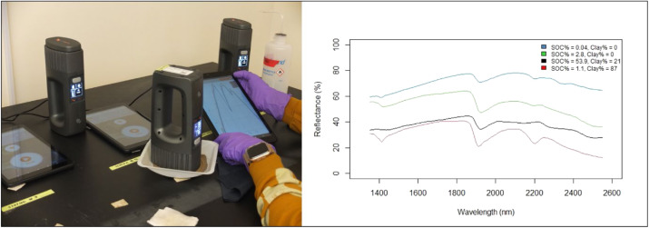
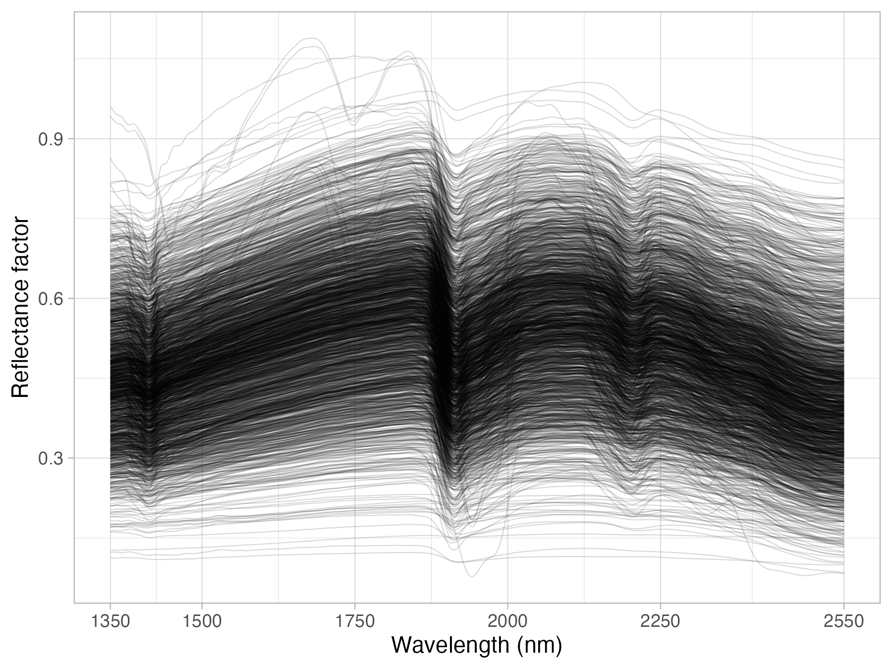
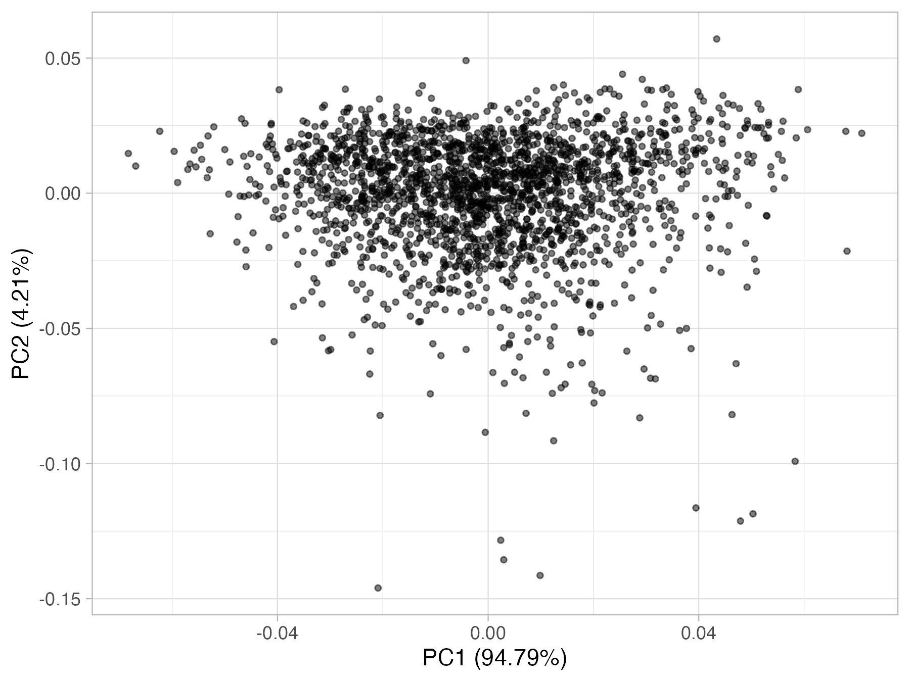

# Neospectra Library {#sec-neospectra}

## Overview

Recent advances in hardware technology have enabled the development of handheld, field-ready sensors with robust scanning specifications comparable to laboratory-grade near-infrared (NIR) spectrometers.

The Soil Spectroscopy for Global Good project has compiled a targeted NIR spectral library spanning the 1350–2550 nm spectral range using previous iterations of the NeoSpectra Handheld NIR Analyzer developed by Si-Ware Systems. With the recent transition and integration of this technology into the Buchi ProxiScout (formerly NeoSpectra by Si-Ware), these existing spectra are readily compatible with the new platform.

Each instrument is equipped with Fourier-Transform Near-Infrared (FT-NIR) technology integrated on semiconductor Micro-Electro-Mechanical Systems (MEMS) chips. This manufacturing approach ensures high repeatability, device-to-device consistency, and laboratory-grade accuracy in portable soil sensing applications.

{width=75%}

## Dataset and scanning methodology

This spectral library comprises 2,106 distinct mineral soil samples scanned across nine portable NIR spectrometers (identified by device serial number). To represent broad soil diversity, 2,016 samples originate from the United States and 90 samples span regional locations across Ghana, Kenya, and Nigeria.

1. Woodwell Climate Research Center Subset (US)
Selected and scanned by the Woodwell Climate Research Center, this subset contains 519 US samples queried from the physical archives of the USDA NRCS NSSC-KSSL Soil Archives.
- Criteria: Samples required complete measured data across eight primary soil properties: total carbon (TC), organic carbon (OC), total nitrogen (TN), cation exchange capacity (CEC), pH, clay, sand, and silt.
- Stratification: Querying was stratified by major horizon and taxonomic order (excluding categories with fewer than 500 total archive samples).
- Selection: A random 3% sample was drawn from each stratum (the combination of major horizon and taxonomic order) and retrieved from the KSSL archive as 2-mm sieved samples.

2. University of Nebraska–Lincoln Subset (US)
The remaining 1,497 US samples were queried from the USDA NRCS NSSC-KSSL physical archive by the University of Nebraska–Lincoln based on the following specific criteria:
- Depth & Chemistry: Lower depth $\le$ 30 cm, pH range 4.0–9.5, and organic carbon $<10\%$.
- Analysis & Archives: Collected and analyzed from 2001 onwards, with available physical samples in the archive, existing mid-infrared (MIR) spectra, and values exceeding lower detection limits.
- Complete Property Suites: Full laboratory data required for high-priority properties: sand, silt, clay, CEC, exchangeable cations (Ca, Mg, K, Na), $\text{CaCO}_3$, OC, and TN.

3. Scanning Protocol
All samples were prepared dry and 2-mm sieved:
- Setup: Approximately 20 g of soil was placed in a plastic weighing boat.
- Measurement: The NeoSpectra scanner head was placed in direct contact with the soil surface and moved gently across the sample while 6 replicate scans were collected.

```{r nir_plot, echo=F, eval=FALSE, include=F, warning=F, message=F}
## Packages
library("tidyverse")
library("curl")
library("qs") # >=0.25.5

nir <- "https://storage.googleapis.com/soilspec4gg-public/neospectra_nir_v1.2.qs"
nir <- qread_url(nir)

old.names <- names(nir)
new.names <- gsub("scan_nir.|_ref", "", old.names)
spectra.columns <- as.character(seq(1350, 2550, by = 2))

p.nir <- nir %>%
  rename_with(~new.names, old.names) %>%
  select(id.sample_local_c, all_of(spectra.columns)) %>%
  group_by(id.sample_local_c) %>%
  summarise_all(mean) %>%
  pivot_longer(-id.sample_local_c,
               names_to = "wavelength", values_to = "reflectance") %>%
  mutate(wavelength = as.numeric(wavelength)) %>%
  ggplot(aes(x = wavelength, y = reflectance, group = id.sample_local_c)) +
  geom_line(alpha = 0.15, size = 0.25) +
  scale_x_continuous(breaks = c(1350, 1500, 1750, 2000, 2250, 2550)) +
  labs(x = "Wavelength (nm)", y = "Reflectance factor", color = "") +
  theme_light()

ggsave("./img/nir_neospectra.png", p.nir, dpi = 300, width = 8, height = 6,
       units = "in", scale = 0.75)
```

```{r nir_pca, echo=F, eval=FALSE, include=F, warning=F, message=F}
nir <- nir %>%
  rename_with(~new.names, old.names) %>%
  select(id.sample_local_c, all_of(spectra.columns)) %>%
  group_by(id.sample_local_c) %>%
  summarise_all(mean)

nir.svd <- svd(scale(nir[,-1], center = T, scale = T))
exp.var <- round(nir.svd$d^2/sum(nir.svd$d^2)*100, 2)
ncomps <- 2

p.pca <- as_tibble(nir.svd$u[,1:ncomps]) %>%
  rename(PC1 = V1, PC2 = V2) %>%
  ggplot() +
  geom_point(aes(x = PC1, y = PC2), color = "black", size = 1, alpha = 0.50) +
  labs(x = paste0("PC1 (", exp.var[1], "%)"),
       y = paste0("PC2 (", exp.var[2], "%)")) +
  theme_light()

ggsave("./img/pca_neospectra.png", p.pca, dpi = 300, width = 8, height = 6,
       units = "in", scale = 0.75)
```


{width=75%}

{width=75%}

## Useful resources

- A **data description** paper was published about the Neospectra dataset. Please refer to it for getting more information about the measurements and model calibration. @Partida2025  
- We analyzed the **consistency** of multiple Neospectra scanners and how models are impacted by the **instrument's variability**. @Mitu2024  
- We developed a study assessing the capacity of the Neospectra scanner in estimating **soil organic carbon stocks** across a few farms in Massachusetts, USA. The paper include the analysis of **global and local modeling strategies**, **uncertainty propagation for inference**, and **cost-benefit analysis**. (add link)

## Database access

Please visit the **Neospectra** card in the [**Soil Spectral Libraries**](#sec-libraries) section for download links and more information.

A persistent copy of the database is hosted on [Zenodo](https://zenodo.org/record/7600137). Please use the following references when using the Neospectra database:

> Partida, C., Safanelli, J. L., Mitu, S. M., Murad, M. O. F., Ge, Y., Ferguson, R., … Sanderman, J. (2025). Building a near-infrared (NIR) soil spectral dataset and predictive machine learning models using a handheld NIR spectrophotometer. Data in Brief, 58(111229), 111229. <https://doi.org/10.1016/j.dib.2024.111229>

> Sanderman, J., Partida, C., Safanelli, J. L., Mitu, S. M., Ge, Y., Murad, O., & Shepherd, K. (2024). Near-infrared (NIR) soil spectral library using the NeoSpectra Handheld NIR Analyzer by Si-Ware (v1.2) [Dataset]. Zenodo. <https://doi.org/10.5281/zenodo.13122321>

