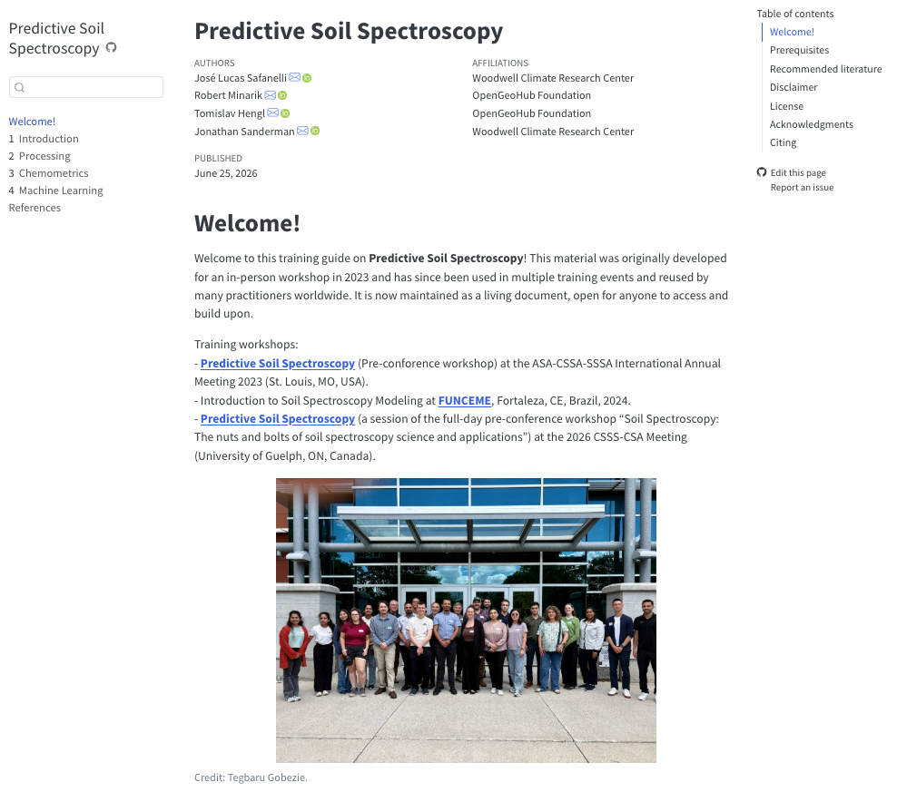

# Hands-on Tutorial {#sec-tutorial}

Originally developed for an in-person training workshop at the CANVAS Meeting in 2023, this hands-on guide has evolved into an open-access living document used across multiple international events, including workshops in Fortaleza, Brazil (FUNCEME, 2024) and at the 2026 CSSS-CSA Meeting in Guelph, Canada.

[{width=100%}](https://soilspectroscopy.github.io/predictive-soilspec-training/)

This material covers the end-to-end development of predictive soil spectroscopy, from project design and building or leveraging large public spectral libraries to data import, preprocessing, resampling, and predictive modeling.

All examples leverage the open-source R ecosystem, utilizing modern `tidy` principles, the `tidymodels` machine learning framework, and `mdatools` for chemometrics. Reproducibility is maintained via `renv`. Dedicated packages like `prospectr`, `resemble`, `asdreader`, and `opusreader2` are also featured to support complete spectral workflows.

We hope this evolving material serves as a practical foundation for exploring predictive soil spectroscopy and building custom applications.
